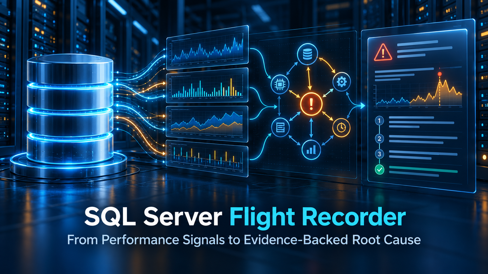

# Agentic AI RCA Toolkit for SQL Server



> **Functional consulting portfolio edition**

This repository contains the working SQL source, operational layer, controlled acceptance workloads, certification record, and sanitized report output for a seven-domain SQL Server root-cause analysis system designed and built by **Louis Achungo**.

It is both a technical portfolio and a retained consulting asset. The code is available for review and controlled evaluation, but no license is granted to deploy, redistribute, sell, or create derivative implementations.

## What it does

The toolkit acts as a database flight recorder. It captures an incident window, correlates Extended Events with sampled server evidence, builds independent cause candidates, applies deterministic cross-domain arbitration, and produces a compact HTML incident report.

## Complements Automatic Plan Correction—Does Not Compete with It

This toolkit does not replace or compete with SQL Server Automatic Plan Correction (APC). APC performs an important but deliberately focused job: it uses Query Store history to detect plan-choice regressions and can force a previously known good plan. Its recommendation evidence centers primarily on CPU-performance statistics, execution counts, and aborted or error counts.

The Agentic AI RCA Toolkit addresses the broader question APC was not designed to answer:

> **Why was the database slow during this exact incident window?**

A slowdown may be caused by blocking, scheduler pressure, storage latency, memory-grant spills, TempDB contention, transaction-log pressure, connectivity failures, or several interacting conditions—even when no plan regression exists. The toolkit correlates evidence across seven performance domains, preserves multiple supported causes, and connects the affected execution to its runtime parameters and matching actual execution plan.

`OPTION (RECOMPILE)` and optimizer-generated plans also require careful interpretation. Recompilation can produce a plan tailored to the current parameter values, but that temporary plan is discarded after execution and introduces compilation cost. Optimizer cardinality and cost estimates are predictions rather than proof of what occurred at runtime. This toolkit therefore emphasizes captured runtime evidence, actual execution behavior, parameter values, and cross-domain correlation instead of treating a compiled or estimated plan as the complete root cause.

**In practical terms:**

- **APC asks:** Did this query regress because SQL Server selected a worse plan?
- **The Agentic AI RCA Toolkit asks:** What actually made the database slow during this incident?

It analyzes:

1. CPU and scheduler pressure
2. Blocking and wait chains
3. I/O and storage latency
4. Memory pressure and grant spills
5. TempDB pressure
6. Transaction-log pressure
7. Connectivity pressure

The report can preserve more than one supported culprit. It also links a selected transaction to captured runtime parameters and its matching actual execution plan.

## Functional source included

| Area | Location | Purpose |
|---|---|---|
| Core engine | [`sql/engine`](sql/engine) | Cumulative schema, capture, parser, evidence-builder, synthesis, and reporting scripts |
| Operations | [`sql/operations`](sql/operations) | Front door, business-hours XE/sampling, target scoping, TLS-aware HTML writer, and final renderer |
| Acceptance | [`sql/acceptance`](sql/acceptance) | Release gate and controlled parameter/plan and multi-culprit workloads |
| Evidence | [`examples`](examples) | Sanitized HTML reports produced by the working system |
| Deployment | [`docs/DEPLOYMENT.md`](docs/DEPLOYMENT.md) | Lab-first installation and verification guidance |

The `sql/engine` directory intentionally preserves the cumulative numbered development chain. Later scripts repair or supersede earlier objects. It is engineering history as well as source; do not execute the folder alphabetically without following the deployment guide.

> [!WARNING]
> **Executable SQL Server code:** This repository contains scripts that create database objects, Extended Events sessions, SQL Agent components, evidence-collection processes, and controlled pressure workloads. Do not execute any script against a production environment without reviewing the code and deployment guide, validating compatibility and permissions, testing in an isolated non-production environment, and preparing approved rollback procedures.

## Demonstrated result

The certified multi-culprit report demonstrates:

- PRIMARY blocking/wait-chain contention;
- PRIMARY memory grant/spill pressure;
- CONTRIBUTING CPU/scheduler pressure;
- multiple impacted requests;
- a winning execution with strict execution-to-plan lineage;
- runtime and compiled parameter values; and
- captured actual execution-plan XML.

Open [`examples/RCA_Incident_Certified_Multi_Culprit.html`](examples/RCA_Incident_Certified_Multi_Culprit.html).

## One business question starts the investigation

The public front door accepts a database name and the local incident window. The toolkit resolves the matching capture internally, preserving `CaptureRunID` as an evidence-lineage key rather than requiring it from the investigator.

```sql
EXEC dbamaint.dbo.usp_RCA_WhyIsDatabaseSlowHTMLV1
     @DatabaseName   = N'YourDatabase',
     @BeginTimeLocal = '2026-08-23T13:56:00',
     @EndTimeLocal   = '2026-08-23T13:59:00';
```

For lab acceptance, the repository uses the disposable database name `RCA_Demo`. Replace it through an environment-specific configuration review; do not point the positive controls at a production database.

## Important operating boundary

This is real SQL Server instrumentation, not a toy package. It uses Extended Events, SQL Agent, server DMVs, and—only for file output—the SQL Server service/proxy identity and `bcp`. Controlled workload scripts deliberately create pressure. Run them only in an isolated non-production lab after reading their headers.

The repository excludes captured `.xel` files, credentials, machine-specific secrets, and personal server identities. Paths, database names, schedules, permissions, certificates, and service identities must be reviewed for each environment.

## Roadmap

The current release is a deterministic, evidence-driven RCA engine. The next stage is an MCP-based AI agent layer, now in development, that will interpret this evidence, reason across performance domains, explain root causes, and recommend corrective actions.

## How to evaluate the work

- Recruiter overview: [`docs/RECRUITER_WALKTHROUGH.md`](docs/RECRUITER_WALKTHROUGH.md)
- LinkedIn technical article: [`docs/LINKEDIN_ARTICLE.md`](docs/LINKEDIN_ARTICLE.md)
- Architecture: [`docs/ARCHITECTURE.md`](docs/ARCHITECTURE.md)
- Deployment and safety: [`docs/DEPLOYMENT.md`](docs/DEPLOYMENT.md)
- Certification: [`docs/CERTIFICATION.md`](docs/CERTIFICATION.md)
- Interview talk track: [`docs/TECHNICAL_TALK_TRACK.md`](docs/TECHNICAL_TALK_TRACK.md)
- Publication boundaries: [`docs/PUBLICATION_SCOPE.md`](docs/PUBLICATION_SCOPE.md)

## Responsible use and support

This repository is provided for technical review, portfolio demonstration, and controlled evaluation. Any implementation must be independently reviewed and adapted for the target environment.

You are responsible for validating SQL Server version and edition compatibility, permissions, security requirements, service identities, file paths, schedules, certificates, workload impact, backups, change controls, and rollback procedures.

Use of this repository is at your own risk. No warranty is provided, and the author is not responsible for data loss, service interruption, performance degradation, security exposure, or other consequences resulting from its use.

For implementation guidance, environment-specific review, or professional assistance, contact [Louis Achungo on LinkedIn](https://www.linkedin.com/in/louis-achungo/).

## 🔗 Connect

- 🌐 Portfolio: https://sql-it-techsolutions.com/  
- 💼 LinkedIn: https://linkedin.com/in/louis-achungo  

---

⭐ If this helped, consider starring the repo.

---

**Louis Achungo**  
Senior SQL Server DBA | SQL Server Architect | Performance Engineering | HA/DR | Azure SQL & AWS

*Building reliable, observable, and scalable database platforms through architecture, automation, and operational excellence.*

---


## Ownership

Copyright © 2026 Louis Achungo. All rights reserved. Source availability is not an open-source license. See [`LICENSE`](LICENSE).

