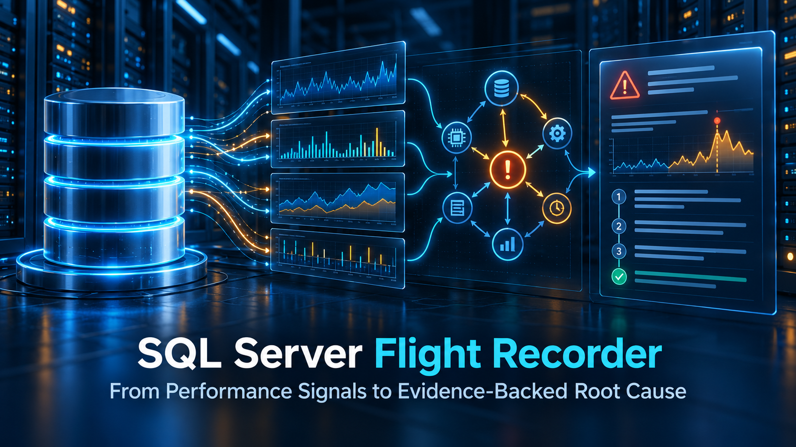
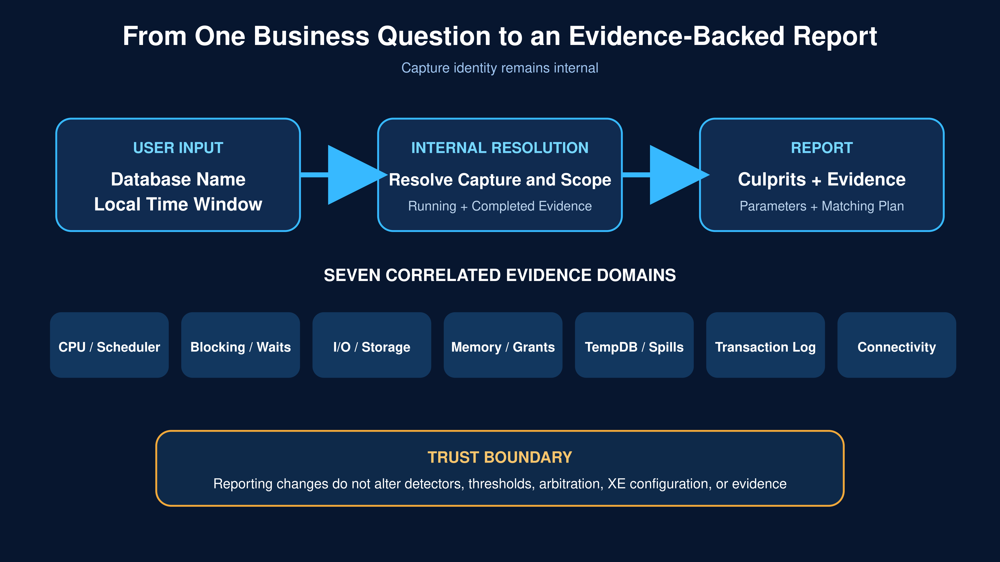
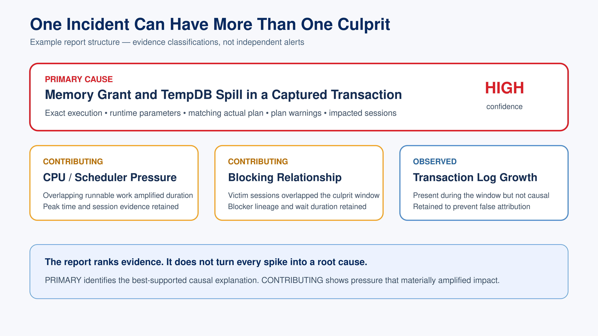
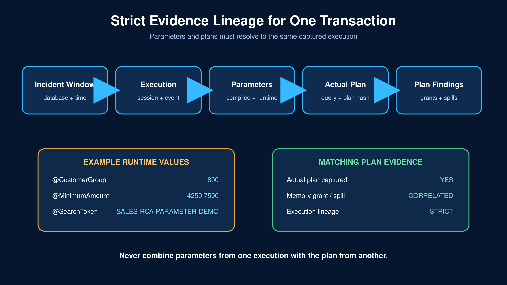

# How I Built a SQL Server Flight Recorder for Root Cause Analysis



**A personally developed SQL Server investigation system that moves from performance signals to evidence-backed root cause.**

Most SQL Server monitoring tools can tell a DBA that CPU was high, TempDB was busy, a memory grant spilled, the transaction log grew, or blocking occurred.

That is useful—but it is not yet root cause analysis.

> **Which transaction caused the slowdown, who was affected, what parameters were used, and what did the matching execution plan actually do?**

That question drove me to build an **Agentic AI RCA Toolkit for SQL Server**. I designed it as a database flight recorder: preserve the incident window, correlate evidence across several performance domains, distinguish primary causes from contributing pressure, and produce a report a DBA can use immediately.

This article explains the architecture, the evidence model, the current report experience, and the production-hardening work that remains.

## One Question Starts the Investigation

The user-facing experience should begin with the question an application owner or DBA is actually asking:

> **Why was the Sales database slow between 1:56 PM and 1:59 PM?**

```sql
EXEC dbamaint.dbo.usp_RCA_WhyIsDatabaseSlowHTMLV1
     @DatabaseName   = N'Sales',
     @BeginTimeLocal = '2026-08-23T13:56:00',
     @EndTimeLocal   = '2026-08-23T13:59:00';
```

Those are the only inputs the investigator should need: **database name and local incident window**.

Internally, the toolkit resolves the matching capture, converts the requested time window, selects the relevant evidence, correlates activity, evaluates the supported causes, and renders the HTML report. A repository identifier such as `CaptureRunID` remains an internal lineage key—not an end-user requirement.



*The public contract begins with a database and time window. Capture identity and evidence lineage remain internal.*

## Why Monitoring Signals Are Not Root Causes

A CPU graph cannot prove that CPU caused the slowdown. A TempDB spike cannot prove that adding files will fix it. A memory alert cannot prove that the server needs more RAM. Transaction-log growth can be either the problem or the consequence of a long-running transaction.

The flight recorder samples and correlates seven evidence domains:

- **CPU and scheduler pressure**
- **Blocking and wait chains**
- **I/O and storage latency**
- **Memory grants and spills**
- **TempDB pressure**
- **Transaction-log pressure**
- **Connectivity failures and latency**

Each detector produces evidence and a candidate explanation. The arbitration layer compares those candidates against the incident window, execution lineage, and causal rules.

> **A detector does not become the answer merely because it observed pressure.**

Blocking can create I/O symptoms. A poor estimate can request an oversized memory grant and spill into TempDB. A long transaction can drive log growth. CPU pressure may be a primary cause in one incident and merely a contributor in another.

The report therefore labels causes as **PRIMARY**, **CONTRIBUTING**, or **NOT CONFIRMED**.

## One Incident Can Have More Than One Culprit

Real incidents rarely fit into one metric. The report is designed to show the main culprit and the important contributing causes in the same investigation.



*One incident window can contain a primary execution problem plus contributing CPU, memory, TempDB, blocking, I/O, log, or connectivity evidence.*

The headline should answer four questions quickly:

1. **What was the primary cause?**
2. **Which transaction or session anchors that conclusion?**
3. **What other pressures contributed?**
4. **What evidence supports each classification?**

The first implementation correctly lists all final causes, but the deepest transaction, parameter, and plan card currently belongs to the winning execution. Expanding that same evidence card to every materially contributing cause is part of the next production-hardening phase.

## The Evidence Chain Must Stay Intact

The strongest part of the design is not the HTML. It is the lineage behind the HTML.

For a transaction to appear as the culprit, the report must preserve this chain:

**Incident window → captured execution → exact parameters → matching actual execution plan → plan findings → causal classification**



*The report must never combine parameters from one execution with the plan from another.*

### A Single Transaction Example

The transaction card should show the submitted statement, the runtime values, and the plan captured for that exact execution.

```sql
EXEC dbo.usp_FindCustomerOrders
     @CustomerGroup = 800,
     @MinimumAmount = 4250.7500,
     @SearchToken   = 'SALES-RCA-PARAMETER-DEMO';
```

The parameter section should distinguish **compiled values** from **runtime values**. That matters because parameter sensitivity can produce radically different cardinality estimates and plan behavior.

- **@CustomerGroup** — `int`  
  Compiled: `100` | Runtime: `800`
- **@MinimumAmount** — `decimal(19,4)`  
  Compiled: `1250.0000` | Runtime: `4250.7500`
- **@SearchToken** — `varchar(40)`  
  Compiled and runtime: `'SALES-RCA-PARAMETER-DEMO'`

The matching plan section should then show:

- Query hash and query-plan hash
- Captured UTC time and session ID
- Actual versus estimated row counts
- Memory grant and spill evidence
- Expensive operators and subtree cost
- Parallelism and warning indicators
- A retrieval command for the exact plan XML

```sql
SELECT ActualExecutionPlanXML
FROM dbamaint.dbo.RCA_PlanEvidence
WHERE PlanEvidenceID = 639;
```

The current renderer preserves strict lineage and can provide the retrieval statement. The next refinement is to attach a usable `.sqlplan` file—or provide an explicit download action—so the DBA can open the matching plan directly in SSMS.

## Running and Completed Activity Belong Together

A flight recorder cannot rely only on completed statements. When an incident is still active, the system must explain both:

- **Running activity:** requests, waits, blockers, memory grants, log use, and current execution state
- **Completed activity:** duration, CPU, reads, writes, captured parameters, and actual plans

The correlation key is the incident window plus database, session, request, query hash, plan hash, and captured-event lineage where available.

This unified running-and-completed view is an architectural requirement. The current certified path is strongest for persisted completed evidence; full live-and-completed presentation remains a production-hardening gate.

## What the HTML Report Should Contain

The finished report should be concise enough for an incident call and deep enough for a DBA investigation:

1. **Executive answer** — confirmed, contributing, or not confirmed
2. **Incident scope** — database, server, local and UTC window
3. **Primary culprit cards** — one card for every material cause
4. **Exact transaction evidence** — statement, session, timings, CPU, reads, writes, waits, and concurrency
5. **Runtime parameters** — compiled and runtime values with strict lineage
6. **Matching plan evidence** — actual plan, grants, spills, estimates, operators, and warnings
7. **Affected sessions** — blocked, overlapping, or same-workload activity
8. **Domain evidence** — CPU, blocking, I/O, memory, TempDB, log, and connectivity
9. **Recommended next action** — tied to evidence, not a generic checklist

If the evidence is insufficient, the correct answer is **ROOT CAUSE NOT CONFIRMED**. A trustworthy RCA system must be willing to say that.

## What Is Already Proven

The working toolkit has demonstrated these capabilities in controlled captures:

- Target-database scoping for I/O and transaction-log snapshots
- A scheduled Extended Events capture feeding persisted evidence
- Captured actual-plan parsing
- Runtime parameters extracted from the matching plan
- Execution-to-plan fallback linkage when stronger RPC or batch-parent lineage is unavailable
- Multi-domain candidate generation and arbitration
- Timestamped HTML rendering and file export
- Atomic deployment patterns for correction scripts

The architecture also protects the diagnostic contract: a report change must not silently alter detector thresholds, arbitration predicates, XE configuration, or persisted evidence.

## Engineering Roadmap

The certified foundation already preserves target-database scope, captured executions, runtime parameters, actual-plan evidence, multi-domain candidates, arbitration, and timestamped HTML reporting.

The next engineering phase expands:

- Automatic database-and-time evidence selection
- Evidence cards for every material contributor
- Direct `.sqlplan` download
- Unified running-and-completed activity
- Additional live and cached plan sources
- End-to-end acceptance automation

**The foundation is functional. Production readiness is enforced through explicit acceptance gates.**

## Why I Built It

After decades working with SQL Server, I have seen the same operational gap repeatedly: teams have plenty of telemetry but still struggle to explain what happened during the exact business window that mattered.

My goal was to connect the layers that are normally investigated separately:

**time window, database scope, sessions, executions, parameters, plans, resource pressure, causal relationships, and an evidence-backed conclusion.**

That is the idea behind the SQL Server flight recorder.

It is not a replacement for an experienced DBA. It is a way to preserve the incident, accelerate the investigation, make the reasoning auditable, and give the DBA a much stronger starting point.

> **Monitoring tells you that something happened. Root cause analysis must prove what happened, why it mattered, and which evidence supports the conclusion.**

---

**Louis Achungo | Principal SQL Server Architect**  
SQL Server performance engineering, high availability, automation, and evidence-driven root cause analysis

#SQLServer #DatabasePerformance #RootCauseAnalysis #ExecutionPlans #DatabaseEngineering

